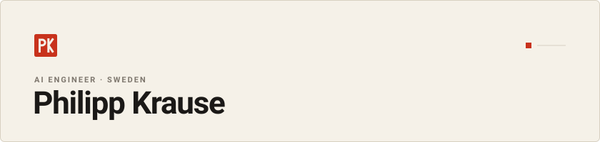

<picture>
  <source media="(prefers-color-scheme: dark)" srcset="assets/header-dark.svg" />
  
</picture>

 

I build AI pipelines and the evaluation that shows whether they work. By day
that is my job at Din Psykolog in Stockholm. The projects below are what I
build on the side.

 

<h3></h3>

**[Satsuma](https://satsuma.space)** · The shopping list that learns your supermarket 
A shopping list and recipe app that installs on the phone. The list learns
the route you walk through your store and is shared live between phones. A
built-in MCP server lets an AI assistant read and edit it. 
SvelteKit · Svelte 5 · TypeScript · Tailwind CSS · Drizzle ORM · PostgreSQL · Supabase · MCP

**[Basoi](https://basoi.com)** · Run the whole tournament from your phone 
A tournament generator for Roundnet and beach volleyball. It draws each
round from the player pool and spreads the rest rounds, so the same people
do not keep sitting out. 
SvelteKit · Drizzle ORM · PostgreSQL

**[URoC](https://uroc.se)** · The site that runs the club 
The official site of Uppsala Roundnet Club. The content sits in a headless
CMS, so the board edits it without a developer. 
SvelteKit · Contentful

**[What Time Is It](https://github.com/brokelyn/whatTimeIsIt-telegram-bot)** · A Telegram bot that referees the 13:37 game 
Write 1337 in the group chat at exactly 13:37 and you score a point. The bot
keeps the score across groups and time zones, and mutes you for the wrong
time. 
Python · python-telegram-bot · peewee · SQLite · Docker

 

<h3></h3>

[pkrause.dev](https://pkrause.dev) · [LinkedIn](https://www.linkedin.com/in/philipp-krause-143a7b218/)
